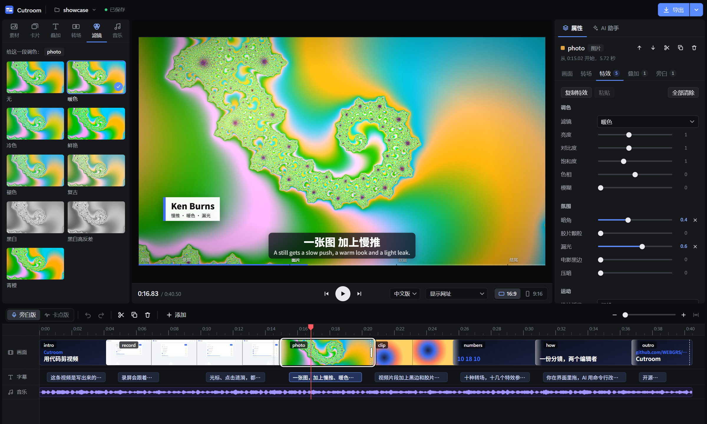
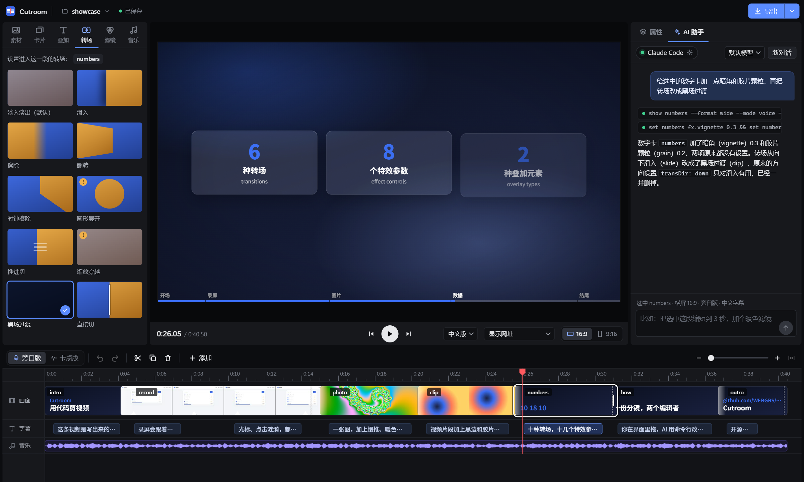
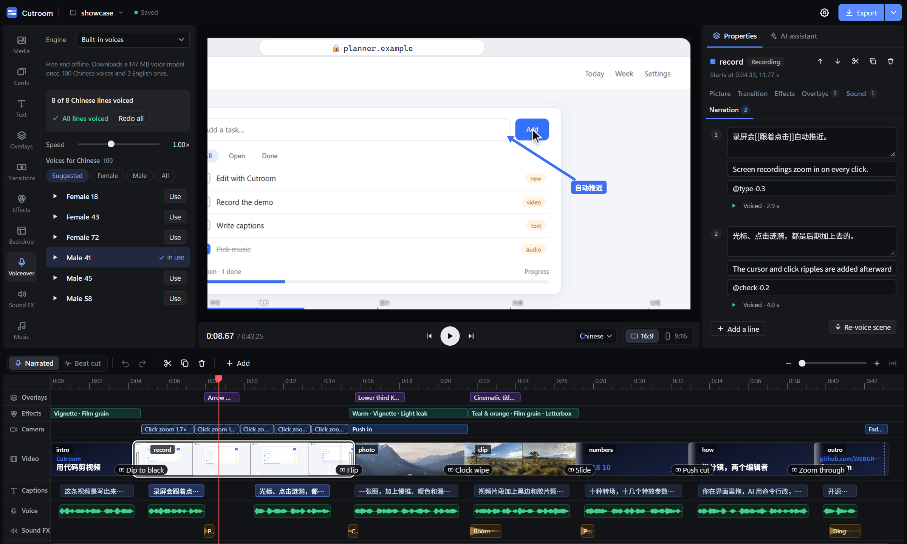
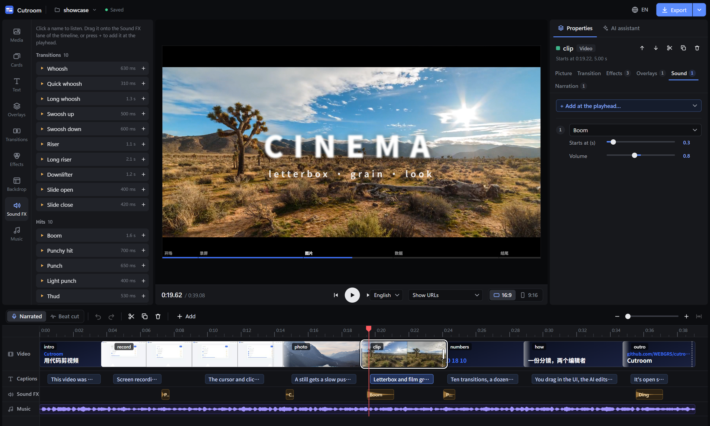

# Cutroom

A video editor where you and an AI assistant edit the same cut. Each video is one `storyboard.json` file: you work on it in a timeline, the assistant changes it from a chat panel, and [Remotion](https://www.remotion.dev) renders it. It can also record websites and voice the narration. Made for product demos, screen recordings and short promos.

[](https://github.com/WEBGRS/cutroom/releases/latest)
[](LICENSE)
[](https://github.com/WEBGRS/cutroom/actions/workflows/ci.yml)



## Why

Most editors store a project as an opaque binary or database. Cutroom stores it as a small JSON document, which means:

- **You and an AI can work on the same cut.** Hold Ctrl and click a spot in the preview, a scene or a caption, then say what you want changed there. The assistant edits through one tool, the editor's CLI; its changes appear in the preview within a second, and it sees the changes you make by hand. Both sides go through the same versioned save path, so neither overwrites the other. Ask it for footage and it records a website for you ("record searching for Remotion on wikipedia.org"); ask for narration and it writes the lines and voices them. It can also look at the video: frames rendered exactly as an export would be, so it checks the text, circles and crops it placed and fixes what it sees.


- **Timing stays tied to content.** Captions and cuts can be anchored to marks recorded with a screen capture (`"@add-0.3"`), so re-recording a demo doesn't break the edit.
- **What you preview is what you export.** The preview is a Remotion Player running the same React composition the renderer uses. A test renders the same frames both ways and compares them; most come out bit-identical.

## Features

- **Timeline**: filmstrip thumbnails, waveforms, drag to reorder, drag edges to trim, split at the playhead, undo/redo, and a beat grid for music cuts. Lanes under the scenes show where every overlay, effect, camera move and sound effect sits, and each cut shows its transition. Drag an overlay or a sound to move it; click any bar to open its settings. Dragged edges, cues and the playhead snap to cuts, recording marks, caption starts, beats and each other (the magnet button or N; hold Alt to drag freely), and edits made by the AI can be undone with Ctrl+Z like your own.
- **Two cuts from one storyboard**: a narrated cut and a beat-synced music cut, each in 16:9 and 9:16.
- **Library panel**: media, cards, text, overlays, transitions, effects, backdrops, voice-over, sound effects and music. Every effect has a rendered preview that plays on hover; one click applies it to the selected scene.
- **182 effects**:
  - 39 transitions (whip pan, glitch, film burn, 3D cube, light leak, tile grid, …)
  - 33 text animations (decode, scramble, typewriter, split-flap, count-up, marker highlight, …), usable on titles, overlays and captions
  - 41 overlays (hand-drawn circles and arrows, notifications, chat bubbles, keyboard keys, AI prompt box, counters, progress rings, confetti, …) and 12 lower-third styles
  - 14 card scenes (bar chart, checklist, testimonial, chat thread, code typing, terminal, before/after wipe, …)
  - 10 animated backdrops
  - 33 scene-effect presets (looks, duotone, RGB split, bloom, CRT, pixelate, handheld drift, focus pull, stop motion, …)
  - Many of the designs are adapted from [HyperFrames](https://github.com/heygen-com/hyperframes); see [CREDITS.md](CREDITS.md).
- **58 sound effects**: whooshes, risers, booms, hits, clicks, typing, notification dings and digital blips. Listen in the library, drag one onto the Sound FX lane, then drag it to the exact frame.
- **Captions**: box, outline or plain styles, any position and size, and most text animations; a Screen Studio-style frame for recordings, frosted cards and a chapter bar.
- **AI voice-over**: pick a voice in Library › Voiceover and press Voice. The built-in voices are free and run offline (100 Chinese, 3 English; a 147 MB model downloads once); OpenAI, Gemini and Qwen voices use your key from Settings › AI. Only lines without current audio are voiced, so editing a line re-voices just that line. Each scene's Narration tab plays its lines and can re-voice them.
- **Screen recordings**: a deterministic browser recorder logs clicks and cursor moves; the editor adds smooth auto-zoom, a synthetic cursor and click ripples afterwards. Record any website from Library › Media › Record a website (a short scroll through the page), or ask the AI assistant to record clicks and typing on it.
- **AI assistant**: works with a Claude subscription (through Claude Code), a ChatGPT plan (through the Codex CLI), a Google account (through the Gemini CLI), a Claude API key, or any OpenAI-compatible API: OpenAI, Gemini, DeepSeek, Qwen, Kimi, GLM, OpenRouter or a local Ollama. See [Connecting the AI](#connecting-the-ai).
- **Export**: MP4, 2× resolution, GIF, ProRes, SRT subtitles and a chapter list. The export menu shows where files go (desktop app: `Documents\Cutroom\exports\editor`), and a finished export offers Play and Show in folder.
- **Settings** (gear icon or Ctrl+,): language, help hints, default lengths and transition for new scenes, which timeline lanes to show, preview loop and volume, hiding URLs for platforms that ban links, the export folder and preset, the AI connection, shortcuts and the thumbnail cache.
- **English and Chinese** interface, chosen in the installer or in Settings.





## Install (Windows)

Download `Cutroom-Setup-<version>.exe` from the [latest release](https://github.com/WEBGRS/cutroom/releases/latest) and run it. The installer is not code-signed, so Windows SmartScreen may say "Windows protected your PC": click **More info**, then **Run anyway**.

The installer asks for a language first. Projects, settings and exports live in `Documents\Cutroom`, so uninstalling never deletes your videos. The first export downloads Remotion's headless browser (about 110 MB) once.

To build the installer yourself, run `npm run dist` from a source checkout; it lands in `dist-app/`.

## Run from source

Requirements: Node.js 22+, [ffmpeg](https://ffmpeg.org) on your `PATH`, and Chrome for screen recordings and browser tests. Developed and tested on Windows 11.

```bash
git clone https://github.com/WEBGRS/cutroom.git
cd cutroom
npm install
npm run setup        # downloads the Noto Sans SC font used for captions
npm run editor       # http://127.0.0.1:8814
```

Or open it as a desktop app:

```bash
npm run app
```

The `showcase` project opens first. It uses every effect type, so it doubles as a reference.

## Connecting the AI

Open the **AI assistant** tab and click the connection pill at its top, or go to Settings › AI.

| Option | What you need |
|---|---|
| **Claude Code login** | A Claude subscription. Install [Claude Code](https://docs.anthropic.com/en/docs/claude-code), run `claude` once in a terminal and sign in, then restart the editor. |
| **ChatGPT plan** | The official [Codex CLI](https://github.com/openai/codex), signed in with your ChatGPT account. |
| **Google account** | The official [Gemini CLI](https://github.com/google-gemini/gemini-cli), signed in with Google (free tier or a Google AI plan). |
| **Claude API key** | A key from the [Anthropic Console](https://console.anthropic.com), pasted in Settings › AI or set as `ANTHROPIC_API_KEY`. Pay per use. |
| **Other models** | A key for OpenAI, Google Gemini, DeepSeek, Qwen (Alibaba Model Studio), Kimi, Zhipu GLM or OpenRouter, or a local [Ollama](https://ollama.com) with no key. Pick a model from the list the provider returns; it must support tool calling. |

- **Codex and Gemini CLI**: Settings › AI can install either one (`npm install -g`) and opens a terminal for its own sign-in. Cutroom starts the CLI with its shell, file and web tools turned off and gives it one tool, the editor, through a small MCP server (`editor/dist/mcp.mjs`). Each request is an ephemeral session, so nothing lands in your own Codex or Gemini history.
- **Keys**: a pasted key is stored only in `.editor/settings.json` on your machine (git-ignored) and is never sent back to the page in full. Keys can also come from `OPENAI_API_KEY`, `GEMINI_API_KEY`, `DEEPSEEK_API_KEY`, `DASHSCOPE_API_KEY`, `MOONSHOT_API_KEY`, `ZHIPUAI_API_KEY` or `OPENROUTER_API_KEY`. For Ollama, pull a tool-capable model first, e.g. `ollama pull qwen3`.
- **Not supported**: Chinese "Coding Plan" keys, because their terms only allow interactive coding tools.

**Test connection** sends one short request through whichever option is active. In auto mode the editor prefers the Claude Code login, then the Claude API key, then a configured other provider. Whichever model answers, the assistant can only run the editor's own CLI on the open project.

## A storyboard

```json
{
  "slug": "my-video",
  "title": "My video",
  "theme": { "accent": "#3b6ef5", "bg": ["#0b1020", "#1a2140"] },
  "scenes": [
    {
      "id": "intro",
      "lines": [{ "zh": "这条视频是写出来的。", "en": "This video was written, not dragged." }],
      "visual": { "kind": "title", "title": "Edit video as code" },
      "fx": { "vignette": 0.35, "grain": 0.2 },
      "sounds": [{ "id": "whoosh", "at": 0.2 }]
    },
    {
      "id": "demo",
      "transition": "dip",
      "lines": [{ "zh": "点哪里，推近哪里。", "en": "It zooms in on every click.", "at": "@add-0.3" }],
      "visual": { "kind": "screen", "src": "cap/planner.mp4", "to": "@filter+1.2" },
      "overlays": [{ "kind": "arrow", "at": 3.6, "text": "auto zoom", "x": 0.62, "y": 0.36 }]
    }
  ]
}
```

`zh` holds the main caption line (any language) and `en` an optional second-language line under it. Run `node editor/dist/cli.mjs fx` for every effect field.

Projects live in `public/<slug>/` together with their media. Create one from the project menu in the editor, or drop images, video and music onto the editor window to import them.

## Editing from the command line

The CLI is what the AI assistant uses, and you can use it too. Changes show up live in an open editor.

```bash
node editor/dist/cli.mjs showcase ls --format tall --mode beat   # timeline as rendered
node editor/dist/cli.mjs showcase trim record --to @filter+0.8   # keeps the mark anchor
node editor/dist/cli.mjs showcase split record 4.2
node editor/dist/cli.mjs showcase set photo fx.look '"warm"'
node editor/dist/cli.mjs showcase add title intro                 # new title card after "intro"
node editor/dist/cli.mjs showcase log --unseen                    # what changed in the UI since you last looked
node editor/dist/cli.mjs showcase check                           # problems to fix before export, each with its fix
node editor/dist/cli.mjs showcase look record photo+2.5           # render frames as an export would, for the AI to look at
node editor/dist/cli.mjs showcase show all                        # every scene's JSON
node editor/dist/cli.mjs showcase media                           # recordings (with marks), images, videos, music
node editor/dist/cli.mjs showcase beat use music/realizer.mp3     # beat-cut music; the tempo comes from its beat data
node editor/dist/cli.mjs showcase voice                           # voice-over for lines without current audio
node editor/dist/cli.mjs showcase voice --lang en --redo          # re-voice the English track
node editor/dist/cli.mjs showcase inspect https://example.com     # a page's clickable elements and their selectors
node editor/dist/cli.mjs showcase record demo https://example.com '[{"wait":800},{"mark":"more"},{"click":"text=\"Learn more\""},{"wait":1500}]'
node editor/dist/cli.mjs fx                                       # every effect field and its range
```

## Keyboard shortcuts

| Key | Action |
|---|---|
| Space | Play / pause |
| ← / → | One frame back / forward (with Shift: one second) |
| Home / End | Go to the start / end |
| S, Ctrl+B or Ctrl+K | Split at the playhead |
| Q / W | Trim the scene's start / end to the playhead |
| Ctrl+D | Duplicate the scene |
| Delete | Delete the selected scene, sound or overlay |
| Ctrl+Alt+C / Ctrl+Alt+V | Copy / paste a scene's effects |
| Ctrl+Z | Undo |
| Ctrl+Shift+Z or Ctrl+Y | Redo |
| N | Snapping on / off (hold Alt while dragging to skip it) |
| Esc | Deselect |
| Ctrl+click | Point the AI at what you click |
| Ctrl+, | Settings |

## How it works

```
 timeline UI ──PUT──┐                         ┌── Remotion Player (preview)
                    ├──► storyboard.json ◄────┤
 AI chat ─► CLI ────┘    (versioned saves,    └── remotion render (export)
                          log + snapshots)
             file watcher ─► server-sent events ─► every open editor
```

- `src/`: the Remotion composition: scenes, camera, captions, effects, transitions.
- `src/fx/`: the effect library: text animations, transitions, overlays, cards, backdrops, scene effects, sounds, and `registry.ts`, the list that drives the UI and the previews.
- `editor/src/`: UI (React), server, CLI, edit operations, the effects catalog behind the UI, the CLI's `fx` listing and the AI's instructions, plus the AI providers (`chat.ts`, `compat.ts`, `agents.ts`, `mcp.ts`), voice-over (`voice.ts`, `voices.ts`) and web recording (`record.ts`).
- `tools/capture.mjs`: deterministic screen recorder. `editor/demo/capture.mjs` shows how to script one.
- `editor/fx/previews.ts`: renders the hover previews into `public/_fx/` (`npm run previews`; `--only transition/whip` for one).
- `app/`: desktop shell; `electron-builder.yml` and `build/installer.nsh` make the installer.

## Tests

```bash
npm test             # unit tests: edit operations, timeline model, effects catalog, AI providers, voice-over, recording, CLI
npm run typecheck
npm run test:e2e     # drives the editor in headless Chrome against a throwaway copy of the showcase
npm run test:oracle  # preview frames vs. Remotion's renderer (PSNR ≥ 50 dB; most frames identical)
npm run test:app     # launches the desktop app hidden and checks it starts and cleans up
npm run test:shots   # screenshots every panel, tab, menu, dialog and error state into .scratch/uishots
```

The e2e, oracle, app and screenshot scripts need the editor running (`npm run editor`) and Chrome installed.

## Limitations

- The timeline is scene-based and always closed up (ripple). There is no free placement on multiple tracks; overlays and sounds attach to scenes instead.
- Twelve of Remotion's shader transitions need an experimental Chrome flag, so they are not offered.
- The built-in voices are clear but not studio quality, and Chinese voices now and then misread a rare word: listen back, or switch to a cloud voice. Your own recording can replace any line through `timings.json`.
- Recording needs Google Chrome or Microsoft Edge. It opens a fresh browser, so pages behind a login can't be recorded.
- Windows only so far, and the installer is unsigned.

## Credits and license

Cutroom is MIT-licensed. Remotion has its own license: free for individuals and companies with up to three employees, while larger companies need a [company license](https://www.remotion.dev/license). The built-in voices are [Kokoro-82M v1.1-zh](https://huggingface.co/hexgrad/Kokoro-82M-v1.1-zh) (Apache-2.0) run through [sherpa-onnx](https://github.com/k2-fsa/sherpa-onnx) (Apache-2.0); the model is downloaded on first use, not bundled. Bundled music and sounds, and the HyperFrames designs the effect library adapts (Apache-2.0), are listed in [CREDITS.md](CREDITS.md).
